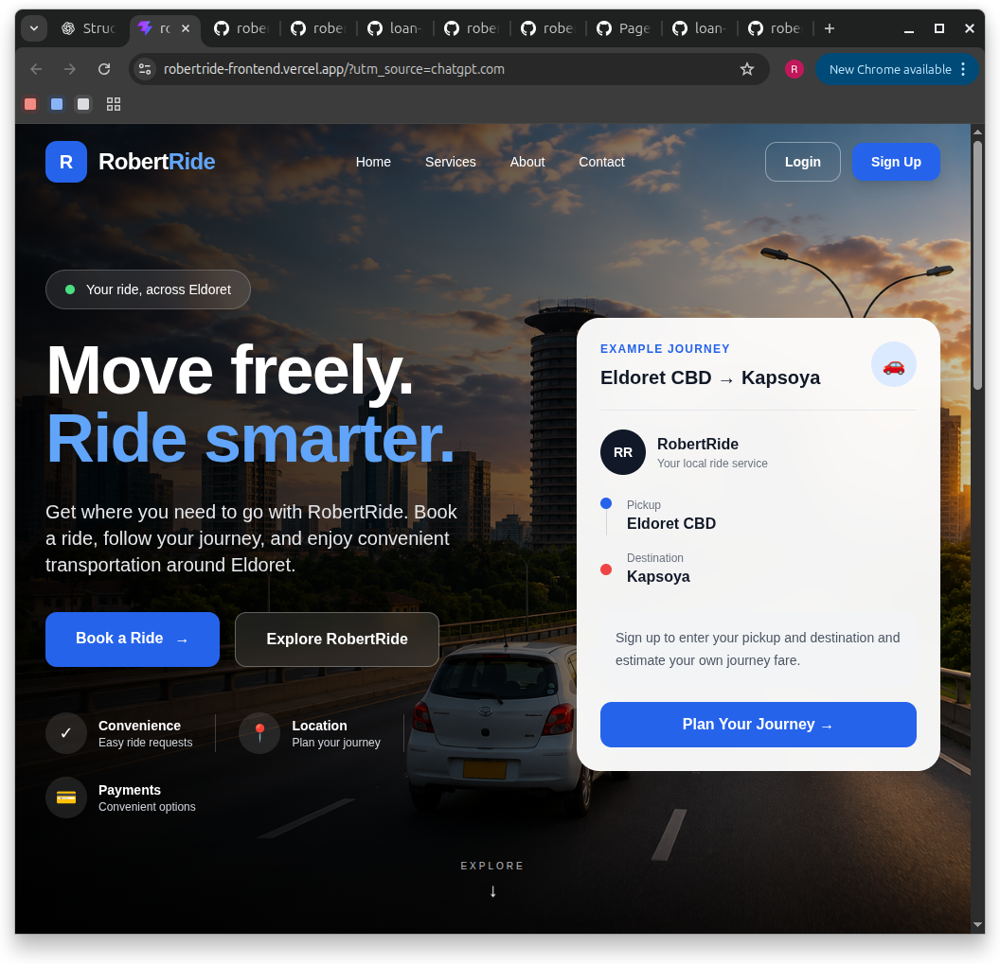
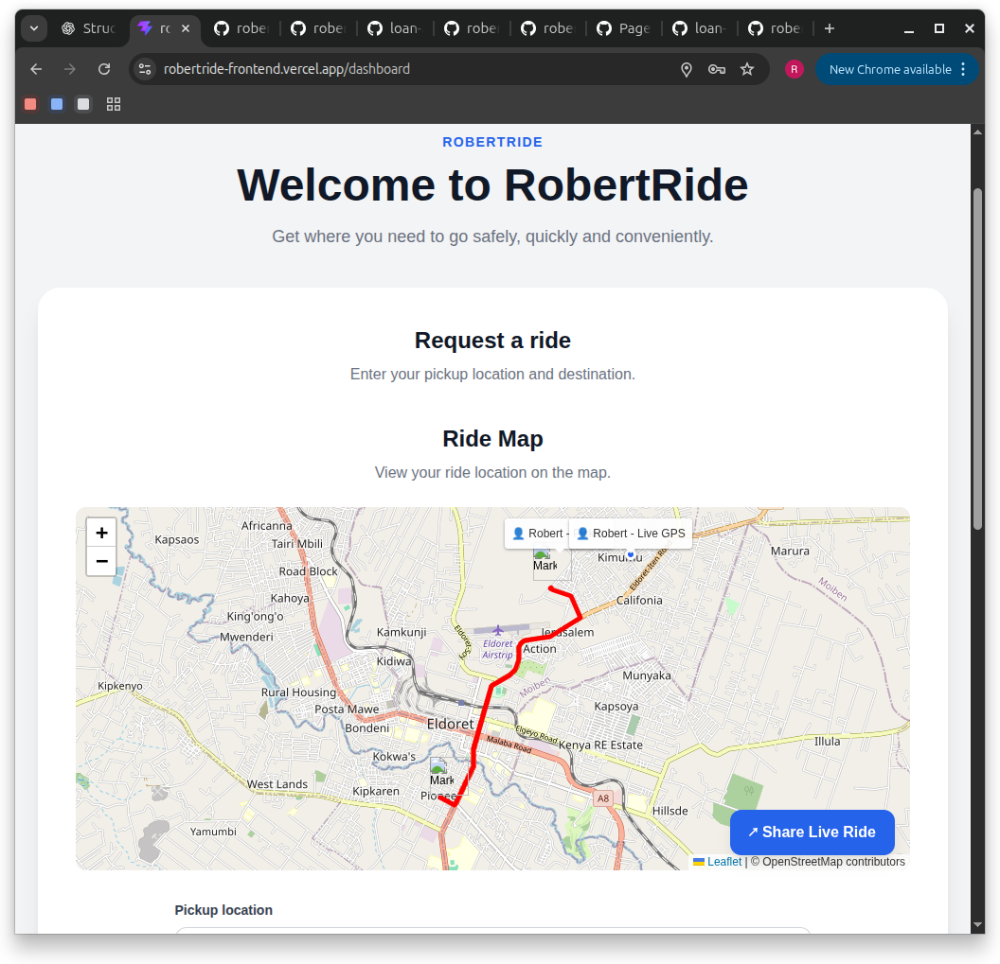

# RobertRide – Frontend

RobertRide is a ride-hailing application designed to connect passengers with drivers through a digital platform.

This repository contains the frontend of RobertRide, providing an interactive user interface for accessing ride services, viewing maps, and tracking driver locations.

## 🚀 Features

- Interactive and responsive user interface
- Driver location tracking using GPS
- Interactive maps with Leaflet
- Ride management interface
- Navigation between application pages
- API communication with the backend
- Responsive design for different screen sizes

## 🛠️ Technologies Used

- **React 19** – Frontend user interface
- **Vite** – Development and build tool
- **Tailwind CSS** – Styling
- **React Router** – Application navigation
- **Axios** – API communication
- **Leaflet** – Interactive maps
- **React Leaflet** – React integration for Leaflet maps
- **JavaScript** – Application logic

## 🌐 Live Demo

[RobertRide – Live Application](https://robertride-frontend.vercel.app)

## 📦 Installation and Setup

### 1. Clone the repository

```bash
git clone https://github.com/robert00-1/robertride-frontend.git
```

### 2. Navigate into the project

```bash
cd robertride-frontend
```

### 3. Install dependencies

```bash
npm install
```

### 4. Start the development server

```bash
npm run dev
```

Open the local URL provided by Vite in your browser.

## 🏗️ Build for Production

To create a production build, run:

```bash
npm run build
```

To preview the production build locally:

```bash
npm run preview
```

## 🔗 Backend Repository

The frontend communicates with the RobertRide backend API.

[RobertRide Backend – GitHub](https://github.com/robert00-1/robertride-backend)

## 👨‍💻 Developer
## 📸 Application Screenshots

### Homepage


### Live Driver Tracking


**Robert Mmasi**

- GitHub: [robert00-1](https://github.com/robert00-1)
- Portfolio: [View My Portfolio](https://portfolio1-zeta-sand.vercel.app)
